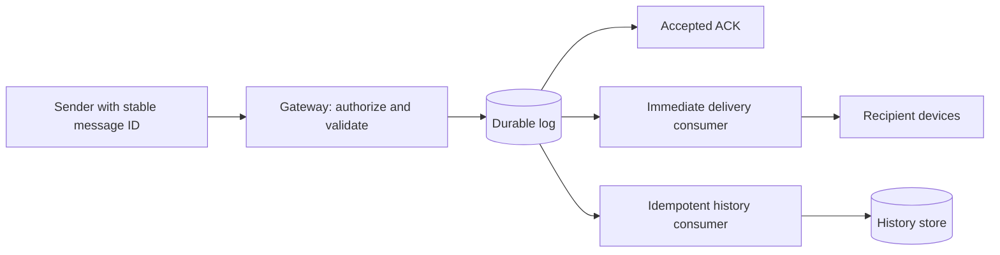

# Example: reviewing a messaging proposal

**Review of a supplied proposal, not a claim about inspected production code.**

## Supplied promises and design

Accepted messages must survive chat-process failure. Online delivery should take less than 500 ms. The proposal responds `sent` immediately, writes Kafka asynchronously, buffers outages in memory with oldest-first eviction, routes through Redis Pub/Sub, and waits for five-second Cassandra batches before delivery.

## Findings

| Claim and evidence | Failure scenario and impact | Correction and verification |
|---|---|---|
| `sent` precedes durable append | Process dies after ACK; accepted message is gone | ACK only after the chosen durable boundary; kill the process immediately after ACK and recover the ID |
| Outage buffer evicts oldest messages | Backlog pressure deliberately discards accepted work | Bound admission before acceptance; return retryable failure and retain client-pending state |
| Pub/Sub is the routing path | A subscriber misses a notification | Use durable replay and device cursors; drop notifications and verify catch-up |
| Five-second batch precedes delivery | A newly arrived message waits almost five seconds | Deliver promptly from durable records; measure the whole path at an agreed percentile |

Pub/Sub routing alone does not prove permanent message loss if another replay path exists. That path is missing from the supplied proposal and must be specified.

## Minimal repaired flow

Configure durability for the promised failure scope. Deduplicate client retries and consumer effects. Track per-device receipt separately from server acceptance. Cassandra history writes may remain asynchronous if the durable log and replay path retain every accepted message through the supported outage and recovery window.

Commit archival consumer progress only after recoverable persistence. Alert on backlog age and stop admission before retention or storage exhaustion destroys unarchived accepted messages. Reconnects replay gaps from retained history; one device ACK does not erase other devices' offline history.

## Remaining decisions

Define the latency percentile, start/end measurement points, network scope, retention, and overload response. Measure throughput and tail latency after the correctness repair. The diagram alone does not establish a 500 ms guarantee.
