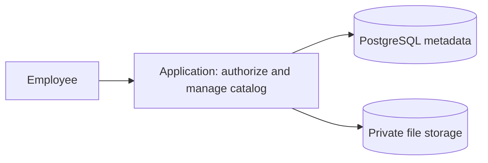

# Example: a small document catalog

**Illustrative design, not a deployed or benchmarked system.**

## Request and recommendation

Two developers support 80 employees in one region. Peak load is 15 requests/s, database data is 2 GB, and files total 40 GB. PostgreSQL and one application already exist. Up to four hours of downtime is acceptable.

Keep one application with modules for catalog, authorization, and files. Keep metadata in PostgreSQL and bytes in private durable file/object storage. These inputs provide no reason to introduce Kafka, Redis, microservices, or database sharding.

The diagram shows logical responsibilities; authorized file bytes may travel directly through a scoped storage URL.

## Assumptions and contract

- Search covers ordinary catalog fields; full document extraction is outside this example.
- Every catalog read and file download checks the user's authorization.
- An attachment becomes visible only after file validation and committed metadata publication.
- Four hours describes recovery time, not acceptable data loss. Define backup RPO separately.

Use indexes for actual filters and sorting. Add a database-backed job and worker only if long-running processing or cleanup is required. Avoid splitting services solely to create more components.

## Failure handling

Track upload intent before issuing an upload capability. A failed publication can be retried using that identity. Reconcile expired intents and unreferenced objects after a grace period; cleanup must not race successful publication. Restore both catalog and referenced files, not only the database.

## Evidence that would change the decision

| Observation | Reconsider |
|---|---|
| Repeated expensive reads remain slow after query/index improvements | Cache with an explicit staleness/invalidation policy |
| Independent consumers need replay beyond a small job queue | Durable event broker |
| A domain needs independent release or failure isolation | Service extraction and its operational cost |
| Measured database limits remain after practical tuning/scaling | Partitioning strategy that preserves required transactions |

## Proposed verification

Exercise representative queries and file transfers at peak traffic plus a stated burst margin. Measure latency, errors, query plans, connection counts, and lock waits. Run a restore exercise for metadata and files and measure it against four hours. None of these measurements has been performed for this example.
